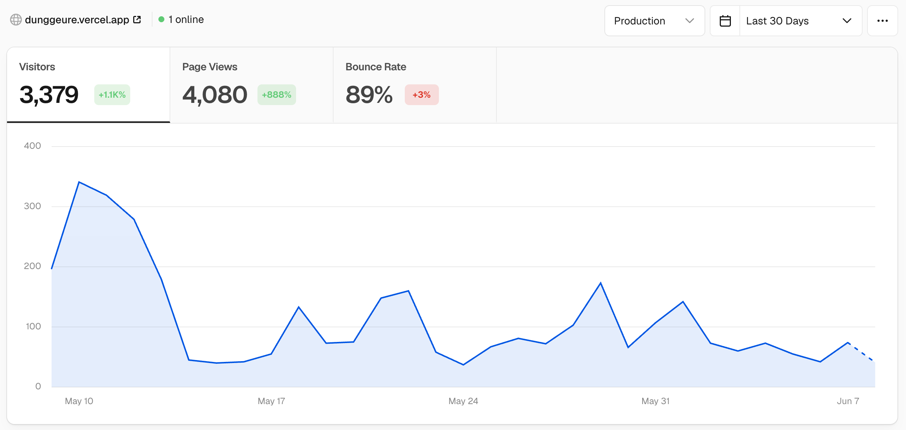

# 둥그레 시간표

치지직 스트리머 둥그레의 방송 일정을 팬들과 공유하는 캘린더 웹앱입니다.
관리자가 월별 방송 일정·공지·데코·스티커를 등록하면, 방문자는 달력에서 한눈에 일정을 확인할 수 있습니다.

<p align="center">
  
</p>

> 🔗 **서비스 바로가기**: https://dunggeure.vercel.app/schedule _(실제 운영 중인 서비스입니다)_

## 주요 기능

- 📅 **월별 캘린더 일정 관리** — 방송 일정 CRUD, 태그, 이미지 첨부
- 🎨 **캘린더 커스터마이징** — 월별 데코/스티커/공지 등록
- 🔐 **인증 & 관리자 권한** — JWT 기반 로그인, 관리자 전용 편집 API
- 🖼️ **이미지 최적화 파이프라인** — 업로드 시 WebP 변환, Cloudflare R2 저장(Supabase Storage fallback)
- 🇰🇷 **정확한 한국 공휴일/시간 처리** — `Asia/Seoul` 기준 날짜 계산, 대체공휴일 보강
- ⚡ **캐싱 & 로딩 UX** — Zustand 캐시, 스켈레톤 UI, 이미지 preload 워밍업

> 이미지 트래픽 최적화, 자정 날짜 하이라이트 동기화, 월 전환 깜빡임 완화 등 실서비스 운영 중 겪은 문제와 해결 과정은 아래 [트러블슈팅](#트러블슈팅) 섹션에 정리되어 있습니다.

## 서비스 지표

실제 팬 커뮤니티에서 운영 중인 서비스로, 배포 후 30일간의 방문 지표입니다.

<p align="center">
  
</p>

- **방문자 수**: 3,379명
- **페이지뷰**: 4,080회
- 측정 기간: 배포 후 30일 (Vercel Analytics)

## 기술 스택

- **Frontend**: Next.js + TypeScript + React
- **스타일링**: Tailwind CSS
- **상태관리**: Zustand
- **DB/Auth/Storage**: Supabase, Cloudflare R2(이미지 저장소 선택)
- **애니메이션**: Framer Motion

## 시작하기

### 1. 의존성 설치

```bash
npm install
```

### 2. 환경변수 설정

`.env.local` 파일에 아래 값을 입력합니다.

- Supabase URL, Anon Key, Service Role Key
- 관리자 초기 비밀번호
- JWT Secret
- 이미지 업로드를 R2로 저장하려면 R2 환경변수

### 3. 개발 서버 실행

```bash
npm run dev
```

## Supabase 마이그레이션

Supabase CLI는 프로젝트 devDependency로 설치되어 있으므로 `npx` 또는 `npm run`으로 실행할 수 있습니다.

### 최초 연결

```bash
npm run db:login
npm run db:link -- --project-ref <project-ref>
```

### 새 마이그레이션 생성

```bash
npm run db:new -- add_example_table
```

생성된 SQL 파일은 `supabase/migrations/` 아래에 추가됩니다.

### 원격 DB에 적용

```bash
npm run db:push
```

### 적용 상태 확인

```bash
npm run db:list
```

기존 호환용으로 `npm run db:migrate`도 `supabase db push`를 실행합니다.

## 이미지 R2 마이그레이션

기존 Supabase Storage에 올라간 일정/스티커/프로필 이미지는 R2 환경변수 설정 후 아래 명령으로 이전할 수 있습니다.
데코 원본 이미지 컬럼이 필요하므로 먼저 `npm run db:push`로 최신 마이그레이션을 적용하세요.

### 대상 확인

```bash
npm run migrate:images-to-r2
```

### 실제 적용

```bash
npm run migrate:images-to-r2 -- --apply
```

마이그레이션 대상은 `schedules.image_url`, `calendar_decorations.image_url/storage_path/original_image_url/original_storage_path`, `stickers.url/storage_path`, `users.avatar_url/avatar_path`입니다. 기본 실행은 `dry-run`이며, `--apply`를 붙여야 R2 업로드와 DB 업데이트가 진행됩니다.

데코 이미지는 일정표 표시용 WebP와 확대 보기용 원본을 함께 저장합니다. 스티커, 일정/공지 업로드 이미지, 프로필 이미지는 GIF를 제외하고 WebP로 최적화해 저장합니다.
월별 공지/데코 메타데이터와 스티커 목록은 Zustand 캐시를 사용해 월 이동과 스티커 팝업 재진입 시 먼저 보여주고 백그라운드에서 갱신합니다.

## 트러블슈팅

### Supabase Storage cached egress 한도를 빠르게 초과하는 경우

증상:

- Supabase 배포 4일 만에 Storage cached egress가 `6.86 / 5 GB (137%)`까지 올라 무료/기본 한도를 초과했습니다.
- 일정표는 이미지가 많은 캘린더 화면이라 새로고침, 월 이동, 팝업 재진입이 반복되면 이미지 트래픽이 빠르게 누적됩니다.

원인:

- 일정 이미지, 데코 이미지, 스티커, 프로필 이미지가 Supabase Storage public URL로 직접 제공되면 이미지 조회 트래픽이 Supabase cached egress로 집계됩니다.
- 데코 원본 이미지와 표시용 이미지처럼 같은 콘텐츠를 여러 용도로 보여주는 경우에도 조회량이 쉽게 늘어납니다.

대응:

- 이미지 저장소를 Cloudflare R2로 이전하고 DB의 이미지 URL과 storage path를 R2 기준으로 갱신했습니다.
- `scripts/migrate-supabase-images-to-r2.mjs`로 기존 `schedules`, `calendar_decorations`, `stickers`, `users` 이미지 데이터를 dry-run 후 `--apply`로 이전합니다.
- 업로드 API는 R2 환경변수가 있으면 R2에 저장하고 없으면 기존 Supabase Storage 경로를 fallback으로 사용합니다.
- GIF를 제외한 업로드 이미지는 WebP로 최적화하고 데코 이미지는 일정표 표시용 WebP와 확대 보기용 원본을 분리 저장합니다.

마이그레이션 후 관찰값:

- Cloudflare R2 `Class A Operations`: 170
- Cloudflare R2 `Class B Operations`: 16.58k

주의:

- R2 전환 후에도 이미지 URL은 변경 시 새 URL을 발급하는 방식을 유지해야 브라우저 장기 캐시(`immutable`)로 인한 이전 이미지 노출을 피할 수 있습니다.
- Supabase Storage fallback 경로를 계속 유지하므로, R2 환경변수 누락 시 다시 Supabase egress가 증가할 수 있습니다.

관련 커밋:

- `feat: 이미지 저장소 R2 연동 및 날짜 표시 안정화`
- `feat: 이미지 R2 마이그레이션 및 최적화 캐싱 개선`

### 자정 이후 오늘 하이라이트가 이전 날짜에 남는 경우

증상:

- 23:59에서 00:00으로 넘어가는 순간에는 오늘 하이라이트가 새 날짜에 정상 적용됩니다.
- 이전/다음 달에서 `오늘` 버튼을 클릭해도 새 날짜 하이라이트가 정상 적용됩니다.
- 하지만 자정 직후 새로고침하면 캐시된 초기 HTML 또는 하이드레이션 상태 때문에 이전 날짜에 `calendar-day-today`가 남아 보일 수 있습니다.

원인:

- 캘린더 셀의 오늘 판정이 React state인 `todayDate` 또는 서버/캐시 HTML의 초기 렌더 상태에 영향을 받으면, 자정 직후 새로고침 시 이전 날짜 class가 먼저 노출될 수 있습니다.
- Next.js가 내려준 초기 HTML과 클라이언트의 실제 한국 시간 계산이 어긋나는 짧은 구간에서는 `useEffect` 동기화가 실행되기 전까지 잘못된 하이라이트가 보일 수 있습니다.

대응:

- 한국 날짜 계산은 `Intl.DateTimeFormat`의 `Asia/Seoul` 기준으로 수행합니다.
- `visibilitychange`, `focus`, `pageshow`, 한국 자정 타이머에서 오늘 날짜를 다시 동기화합니다.
- 캘린더 셀의 오늘 판정은 렌더 시점의 `getKoreaToday()` 값을 사용합니다.
- 최종적으로 오늘 하이라이트 class는 클라이언트 마운트 이후에만 계산해 캐시된 초기 HTML의 이전 날짜 class가 노출되지 않도록 합니다.

관련 커밋:

- `fix: 오늘 날짜 표시 동기화 보강`
- `fix: 오늘 하이라이트 렌더 기준 보정`
- `fix: 새로고침 시 이전 날짜 하이라이트 방지`

### 일정은 보이는데 스켈레톤 UI가 계속 남는 경우

증상:

- 새로고침 후 이번 달 일정 텍스트와 이미지 일부가 이미 그려졌는데도 빈 일정 칸에 스켈레톤 UI가 계속 표시됩니다.

원인:

- 일정 API 응답 후 이미지 preload가 끝나야만 `isSchedulesLoading`이 false가 되는 구조에서는 이미지 로딩이 지연되거나 브라우저 캐시의 `load` 이벤트를 놓치면 로딩 상태가 오래 유지될 수 있습니다.

대응:

- 일정 데이터 응답을 받으면 이미지 preload 완료 여부와 무관하게 즉시 `isSchedulesLoading`을 false로 바꿉니다.
- 이미지 preload는 백그라운드 워밍업으로만 처리합니다.
- `LoadingImage`는 `img.complete`와 `naturalWidth`를 확인해 캐시된 이미지의 `load` 이벤트 누락에도 스켈레톤을 종료합니다.

관련 커밋:

- `fix: 일정 로딩 스켈레톤 종료 조건 보강`

### 월 전환 시 이미지가 깜빡이는 경우

증상:

- 한 번 본 달로 다시 이동해도 일정/데코 이미지는 캐시된 것처럼 빨리 보이지만 월 전환 순간 이미지가 잠깐 투명해지거나 스켈레톤이 보입니다.

원인:

- 월별 일정/데코 데이터와 브라우저 이미지 파일은 캐시되지만 `LoadingImage`의 `loaded` 상태는 컴포넌트 로컬 state라 월 전환으로 언마운트/리마운트되면 다시 false에서 시작합니다.

대응:

- 이미지 `src`별 로드 완료/실패 상태를 메모리 Set에 기록합니다.
- preload가 끝난 이미지도 같은 Set에 기록합니다.
- 이미 본 `src`는 `LoadingImage`가 처음부터 loaded 상태로 렌더링해 스켈레톤과 opacity 전환을 다시 거치지 않게 합니다.

주의:

- 이 캐시는 이미지 파일 내용을 저장하지 않고 `src`가 이미 처리됐다는 UI 상태만 저장합니다.
- 현재 업로드 코드는 `Date.now()`와 `crypto.randomUUID()`로 매번 새 이미지 URL을 만들기 때문에 이미지 교체 시 새 URL이 표시됩니다.
- 나중에 같은 URL에 파일만 덮어쓰는 방식으로 바꾸면 브라우저의 장기 캐시(`immutable`) 때문에 이전 이미지가 보일 수 있으므로 이미지 변경 시에는 새 URL을 유지하는 것이 안전합니다.

관련 커밋:

- `fix: 월 전환 시 캐시 이미지 깜빡임 완화`

## 프로젝트 구조

```text
src/
├── app/
│   ├── page.tsx            # /schedule로 리다이렉트
│   ├── login/              # 로그인 페이지
│   ├── schedule/           # 시간표 페이지
│   ├── settings/           # 닉네임/프로필/비밀번호 설정
│   └── api/
│       ├── auth/           # 인증
│       ├── schedule/       # 일정 CRUD + 태그
│       ├── decorations/    # 달력 장식
│       ├── notices/        # 월별 공지
│       ├── stickers/       # 스티커
│       └── upload/         # 일정 이미지 업로드
├── components/
├── lib/
├── stores/
├── styles/
└── types/
```

## 라이선스

이 프로젝트는 [MIT License](LICENSE)를 따릅니다.
